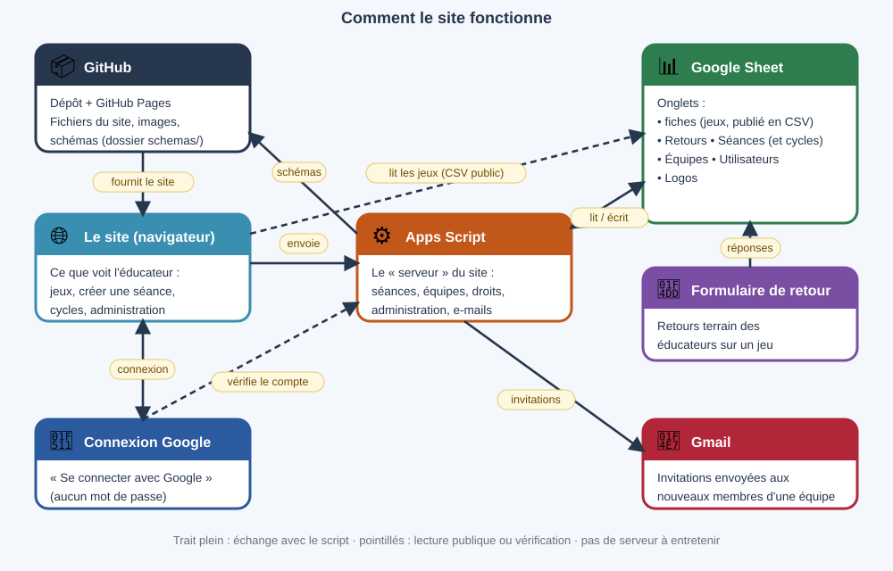

# Documentation technique et maintenance

Ce document décrit **tout** ce qu'il faut savoir pour maintenir le site seul : architecture, emplacement des données, échanges entre GitHub et Google, procédures et dépannage.
Il est dans le dépôt (`docs/maintenance.md`) et s'affiche dans le site (Administration > Documentation). **Mettez-le à jour à chaque changement** (voir « Journal des changements » en bas).

## 1. Vue d'ensemble

Le site est **statique** : aucun serveur à lui, aucune compilation. Ce sont des fichiers HTML/CSS/JS servis par **GitHub Pages**. Tout ce qui est « dynamique » passe par Google :

- **lecture** : le navigateur télécharge des feuilles Google **publiées en CSV** (public, sans mot de passe) ;
- **écriture** : le navigateur envoie un `POST` à un **script Apps Script** (une « application web » Google), qui écrit dans le Google Sheet ou dans le dépôt GitHub.



Points clés :

- Aucune base de données classique : **le Google Sheet est la base**, le dépôt GitHub contient le code, les images et un jeu de données de secours.
- Le site marche même si Google est indisponible (données de secours intégrées), mais les écritures échouent.
- Rien n'est stocké côté site sur les personnes : les brouillons (séance en cours, logo…) restent dans le navigateur (`localStorage`).

## 2. Où sont les données

| Donnée                                        | Emplacement                                                                                                   | Qui écrit                                             | Qui lit                                         |
| --------------------------------------------- | ------------------------------------------------------------------------------------------------------------- | ----------------------------------------------------- | ----------------------------------------------- |
| Code, HTML, CSS                               | dépôt GitHub (dossiers `core/`, `features/`, `css/`)                                                          | vous (Commit & Push)                                  | navigateur                                      |
| 36 jeux d'origine (secours)                   | `data/jeux.js` (constante `EMBED`)                                                                            | généré une fois, ne pas éditer                        | site, si la feuille est inaccessible            |
| Textes annexes (familles, objectifs, guides…) | `data/annexes.js` (constante `AX`)                                                                            | vous                                                  | site                                            |
| Vignettes des 36 jeux                         | `cartes/CODE.jpg`                                                                                             | vous                                                  | liste des jeux                                  |
| Schémas des 36 jeux                           | `schemas/CODE.webp`                                                                                           | vous                                                  | fiche d'un jeu                                  |
| Nouveaux schémas                              | `schemas/NOM.png` (+ `schemas/CODE.json`, dessin source, pour ceux faits depuis Administration) dans le dépôt | script Apps Script (API GitHub)                       | fiche d'un jeu (via « Schéma (lien) »)          |
| **Tous les jeux** (nouveaux compris)          | Google Sheet, onglet des fiches (colonnes `Titre` + `Principe`)                                               | formulaire, « Ma séance », page Administration        | site (CSV publié)                               |
| Séances créées avec l'outil                   | Google Sheet, onglet `Séances`                                                                                | script (action `seance`)                              | site (CSV publié) + copie dans le navigateur    |
| Retours de terrain                            | Google Sheet, onglet des retours                                                                              | popup « Donner mon retour » du site (action `retour`) | site (CSV publié, lignes dont « Publié » = OUI) |
| Séances en Word / PDF / Docs                  | dossier Google Drive (`LIBRARY_URL`)                                                                          | éducateurs                                            | iframe Drive                                    |
| Séance en cours, logo, préférences            | `localStorage` du navigateur                                                                                  | le site                                               | le site                                         |

Règle importante : **quand la feuille répond, elle remplace les données intégrées.** Pour corriger un jeu, modifiez sa ligne dans la feuille (ou la page Administration), pas `data/jeux.js`.

## 3. Le Google Sheet

Un seul classeur, plusieurs onglets (les noms libres sauf `Séances`) :

### 3.1 Onglet des fiches de jeux

Reconnu par le script grâce à la présence des colonnes `Titre` et `Principe`. Colonnes utilisées par le site (le nom doit être exact) :

`Horodateur` · `Code` · `Titre` · `Famille` · `Résumé` · `Principe` · `Participants` · `Effectif court` · `Espace` · `Matériel` · `Durée` · `Intensité` · `Objectif` · `Objectifs (tags)` · `Plus facile` · `Plus difficile` · `Conseil` · `Compléments` · `Voir aussi` · `Auteur` · `Schéma (lien)` · `Format anniversaire` · `Publié`

- `Publié` : la ligne n'apparaît sur le site que si la valeur est `OUI` (aussi acceptés : yes, true, 1, x, ✓). `REFUSÉ` est écrit par la page Administration pour écarter un jeu.
- `Code` : lettre(s) de la famille + numéro (E = Exploration, C = Coopération, D = Défis, G = Animation). Le tri du catalogue est lettre puis numéro.
- `Schéma (lien)` : URL d'une image. Un lien Google Drive est converti en miniature ; une URL du site (`https://…/schemas/xx.png`) est utilisée telle quelle.
- `Plus facile`, `Plus difficile` : une idée par ligne ; la puce « • » est ajoutée automatiquement à l'affichage et à l'enregistrement.
- Ajouter une colonne n'est utile que si le code la lit (voir `features/jeux/fiche.js`) : les colonnes inconnues sont ignorées, mais la page Administration les propose toutes à l'édition.

### 3.2 Onglet `Séances`

Créé automatiquement par le script à la première séance enregistrée.

`id` · `Horodateur` (ISO) · `Titre` · `Thème` · `Éducateurs` · `Dates` · `Exercices` (nombre) · `Données` (JSON complet de la séance, 49 000 caractères max) · `Publié` (`OUI`) · `Propriétaire` (e-mail du compte) · `Nom` · `Partage` (e-mails séparés par des virgules). Les trois dernières colonnes sont créées toutes seules ; une ligne sans propriétaire appartient au premier administrateur. Les **cycles** sont dans le même onglet (`id` commençant par `cy`).

La liste du site lit surtout `Données` (titre, auteur, date, thème, objectif sont relus dans le JSON).

### 3.3 Onglet des retours

Alimenté par le formulaire « Retour terrain » (colonnes `Code du jeu`, `Note` ou `Ça a marché ?`, `Ce qui a bien marché`, `À changer`, `Auteur`, `Public`…). Une colonne `Publié` = `OUI` est ajoutée à la main pour afficher un retour.

### 3.4 Publication CSV

Fichier > Partager > **Publier sur le Web** > choisir **l'onglet** (pas « Document entier ») > format **CSV** > Publier. L'adresse obtenue va dans `config.js`. Il faut une adresse **par onglet** (fiches, séances, retours). Google met à jour le CSV publié avec un délai de quelques minutes.

**Confidentialité** : un onglet publié est lisible par toute personne qui connaît l'adresse, et `config.js` est dans un dépôt public. Tout ce qui est dans ces onglets (y compris les jeux non publiés et les séances) est donc techniquement lisible. Ne mettez rien de confidentiel dans ces feuilles.

## 4. Configuration : `config.js`

Fichier à la racine, **le vôtre** : il n'est jamais écrasé par une mise à jour (il n'est pas dans les zips livrés). Il définit `window.SITE_CONFIG`, fusionné avec les valeurs par défaut de `core/defaults.js` (objet `CONFIG`).

| Clé                                         | Rôle                                                                                                                                                     |
| ------------------------------------------- | -------------------------------------------------------------------------------------------------------------------------------------------------------- |
| `SHEET_CSV_URL`                             | CSV publié de l'onglet des fiches                                                                                                                        |
| `SEANCES_CSV_URL`                           | CSV publié de l'onglet `Séances`                                                                                                                         |
| `RETOURS_CSV_URL`                           | CSV publié de l'onglet des retours                                                                                                                       |
| `FORM_URL`                                  | lien du formulaire « Proposer un jeu »                                                                                                                   |
| `RETOUR_FORM_URL`                           | lien du formulaire « Retour terrain »                                                                                                                    |
| `TEMPLATE_SEANCE_URL`, `TEMPLATE_CYCLE_URL` | modèles Google Docs (onglet « Drive et modèles » de « Séances et cycles »)                                                                               |
| `LIBRARY_URL`                               | dossier Drive de la bibliothèque (onglet « Dossier Google Drive »)                                                                                       |
| `GAME_ADD_URL`                              | adresse `/exec` de l'application web Apps Script (**une seule pour tout**)                                                                               |
| `GOOGLE_CLIENT_ID`                          | identifiant client OAuth Google (pas un secret). Vide = pas de comptes (ancien fonctionnement)                                                           |
| `GAME_ADD_KEY`                              | mot de passe « du site » : doit être identique à `CLE_SITE` dans le script. Visible publiquement : ce n'est pas un secret, seulement un filtre anti-spam |
| `SCHEMA_UPLOAD_URL`, `SCHEMA_UPLOAD_KEY`    | obsolètes : à laisser vides (si renseignés, l'envoi des schémas utilise l'ancien script)                                                                 |

Ne mettez **jamais** dans `config.js` : le mot de passe administrateur, le jeton GitHub.

## 5. Le script Apps Script : `scripts-google/serveur_site.gs`

Un seul projet Apps Script, lié au Google Sheet (Extensions > Apps Script). Il est déployé en **application web** : Exécuter en tant que **Moi**, accès **Tout le monde**. Son adresse `/exec` est `GAME_ADD_URL`.

### 5.1 Constantes à renseigner (en haut du fichier)

`CLE_SITE`, `MOT_DE_PASSE_ADMIN`, `GITHUB_JETON`, `GITHUB_DEPOT` (« compte/depot »), `GITHUB_BRANCHE`, `URL_DU_SITE` (avec `/` final), `NOM_FEUILLE` (vide en général).
Ce fichier est **privé** : ne le copiez pas dans le dépôt avec vos vraies valeurs.

### 5.2 Protocole

Le site envoie `POST` avec `Content-Type: text/plain;charset=utf-8` (pour éviter la requête CORS préliminaire que Apps Script ne gère pas) et un corps JSON. Réponse : `{"ok":true,…}` ou `{"ok":false,"error":"…"}`.

| `action`            | Mot de passe                   | Corps                                                                         | Effet                                                                                                                                |
| ------------------- | ------------------------------ | ----------------------------------------------------------------------------- | ------------------------------------------------------------------------------------------------------------------------------------ |
| `jeu` (ou absente)  | `key` = `CLE_SITE`             | `jeu:{Titre,Principe,…}`                                                      | ajoute une ligne **non publiée** dans l'onglet des fiches (puces ajoutées à `Plus facile/Plus difficile`)                            |
| `seance`            | `key`                          | `seance:{id,titre,theme,educ,dates,nb,data}`                                  | crée ou met à jour la ligne de l'onglet `Séances` (clé = `id`)                                                                       |
| `seance_suppr`      | `key`                          | `id`                                                                          | supprime la ligne                                                                                                                    |
| `schema`            | `key`                          | `name`, `data` (PNG en base64)                                                | écrit `schemas/NOM.png` dans le dépôt via l'API GitHub (`PUT /contents`), renvoie `url`                                              |
| `admin_liste`       | `admin` = `MOT_DE_PASSE_ADMIN` | `tous` (booléen)                                                              | renvoie `colonnes` et `jeux:[{ligne,valeurs,publie}]` (en attente, ou tous)                                                          |
| `admin_enregistrer` | `admin`                        | `ligne`, `titreAvant`, `valeurs`, `publier`, `retirer`                        | écrit les champs ; `publier` met `Publié`=`OUI`, `retirer` le vide                                                                   |
| `admin_refuser`     | `admin`                        | `ligne`, `titreAvant`                                                         | met `Publié`=`REFUSÉ`                                                                                                                |
| `schemas_liste`     | `key`                          | —                                                                             | même résultat que `admin_schemas`, pour le sélecteur du formulaire « Proposer un jeu » (sans mot de passe administrateur)            |
| `admin_schemas`     | `admin`                        | —                                                                             | liste les images du dossier `schemas/` du dépôt (API GitHub) : `schemas:[{nom,url}]`                                                 |
| `admin_schema`      | `admin`                        | `ligne`, `titreAvant`, `code`, `data` (PNG base64), `source` (JSON du dessin) | écrit `schemas/CODE.png` et `schemas/CODE.json` dans le dépôt, met à jour `Schéma (lien)` (URL avec `?v=` anti-cache), renvoie `url` |

`titreAvant` protège contre les modifications concurrentes : si le titre de la ligne a changé depuis le chargement, l'écriture est refusée (« rechargez la liste »).

### 5.3 Déployer une modification

1. Coller le code, **Enregistrer**.
2. Exécuter `testerConnexions` (menu des fonctions) : accepte les autorisations et affiche dans le journal l'état de la feuille, du jeton GitHub et des mots de passe.
3. Déployer > Gérer les déploiements > ✎ > **Nouvelle version** > Déployer. L'adresse `/exec` ne change pas. Sans cette étape, le site utilise l'ancienne version.

### 5.4 Jeton GitHub

GitHub > Settings > Developer settings > Personal access tokens. Soit « Fine-grained » (dépôt choisi, permission _Contents : Read and write_), soit « classic » avec la case `repo`. Il expire : quand les envois de schémas échouent avec « GitHub a refusé (401) », créez un nouveau jeton et remplacez `GITHUB_JETON`.

### 5.5 Autres scripts (`scripts-google/`)

- `creer_formulaire.gs` : crée le formulaire « Proposer un jeu » et le relie au Sheet (à exécuter une fois).
- `creer_formulaire_retour.gs` : idem pour « Retour terrain ».
- `recevoir_schemas.gs` : **ancien** (envoi vers Drive), remplacé par l'action `schema`. Peut être supprimé.

## 6. Le code du site

### 6.1 Principes

- Pas de bundler, pas de modules ES : des `<script>` classiques chargés **dans l'ordre** par `index.html` partagent une même portée globale. L'ordre compte : une fonction doit être définie avant d'être **appelée** au chargement (les fonctions utilisées plus tard, au clic, peuvent être définies après).
- Tout fichier JS/CSS nouveau doit être ajouté dans `index.html` (avant `core/main.js`).
- Formatage : Prettier (`.prettierrc` : 100 colonnes, 2 espaces, `trailingComma es5`, `arrowParens avoid`).
- Cache : chaque fichier est appelé avec `?v=NN`. **À chaque livraison, changez `NN` partout** dans `index.html` (rechercher/remplacer) : sinon les visiteurs gardent d'anciens fichiers.

### 6.2 Arborescence

```
index.html            liste ordonnée des CSS/JS
config.js             vos adresses (jamais écrasé)
docs/maintenance.md   ce document
core/                 moteur : defaults, state, utils, games, registry, nav, router, render, sheet, main
features/             un dossier par fonctionnalité
  home/ jeux/ retours/ guides/ biblio/ seance/ editeur/ admin/ (admin.js, comptes.js, doc.js)
data/                 jeux.js (EMBED), annexes.js (AX)
cartes/ schemas/      images
css/                  base.css, responsive.css (mobile + impression)
scripts-google/       scripts Apps Script (copies de référence)
```

#### Favoris, duplication, filtres, contrôle (v54)

- **Favoris** : `favoris.js`, clé `favJeux` du navigateur suffixée par le compte (`compteSuffixe`) ; vue `fav`. Depuis la v56, synchronisés avec le serveur pour les comptes connectés (voir v56).
- **Dupliquer** : `sbDupliquer` (séances) et `cyDupliquer` (cycles) copient dans « Créer une séance / un cycle » sans identifiant, avec « (copie) » dans le titre.
- **Recherche dans les noms de jeux** : la colonne `Jeux` (codes et noms, 600 caractères) est écrite par `enregistrerSeance` ; les séances enregistrées avant la v54 ne sont retrouvées par nom de jeu qu'après un nouvel enregistrement.
- **Filtres** (`filtres.js`) : la liste de suggestions `#gl` est reconstruite selon famille, objectif, intensité, durée (≤ valeur maximale lue dans « Durée »), sans matériel, sans expérience.
- **Contrôle** (`controle.js`) : encadré sous « Bas de fiche », mis à jour à chaque saisie (`upd` dans `actions.js`) ; la durée prévue est `SMETA.groups[i].prevu`.

#### Modèle de fiche CREPS (v50)

`features/seance/creps.js` ajoute une 2ᵉ présentation de la même séance (mêmes données `SE` / `SMETA`). `sheetHTML()` (fiche.js) et `buildSeanceDoc()` (export-word.js) y renvoient quand `SMETA.modele === "creps"`. Champs propres au modèle : `cp_obj`, `cp_but`, `cp_cons`, `cp_comp`, `cp_orga` (dans chaque exercice, et dans `SE.ech` pour l'échauffement) ; s'ils sont vides, on reprend la fiche du jeu (objectif, résumé, principe, matériel, variantes). Les critères de réussite et les variantes viennent de « Corps de séance ». La page de schémas reprend le schéma de chaque jeu de la bibliothèque ; dans le fichier Word, les images du site sont téléchargées et converties en PNG (`crepsPreload`) ; une image inaccessible (ex. lien Google Drive bloqué par le navigateur) laisse une case vide et le message du bouton Word le signale. `SMETA.schemaMode` vaut `page` (défaut) ou `sous` (une bande « schéma » sous chaque situation). Les colonnes sont décrites dans `CREPS_COLS`.

### 6.3 Le registre (`core/registry.js`)

Chaque fonctionnalité se déclare elle-même :

- `registerView({match, html, bind, fallback})` : une page. `match(v)` dit si la page gère l'adresse `#/v`, `html(v)` renvoie le HTML, `bind(v)` branche les événements après affichage.
- `registerNav({sec, secOrder, order, html})` : une entrée du menu (sections : 0 accueil, 10 LES JEUX, 20 PARCOURIR, 30 MES SÉANCES, 40 GUIDES, 50 ADMINISTRATION).
- `registerClick(fn)` : gestionnaire de clic global ; `fn(e)` renvoie `true` si le clic est traité (les suivants sont ignorés). L'ordre de déclaration (donc de chargement des scripts) décide de la priorité : `core/main.js`, chargé en dernier, gère les `[data-go]` et `[data-jeu]` en dernier recours.
- `registerLoader(async fn)` : chargements de données au démarrage (`loadSheet`, `loadRetours`, `loadSeances`).

### 6.4 Démarrage (`core/main.js`)

Affichage immédiat avec les données intégrées (`route()`), puis `Promise.all` de tous les loaders ; ensuite menu et page sont reconstruits (`buildNav(); render()`). Une page qui lève une exception affiche un cadre rouge au lieu de planter le site.

### 6.5 Navigation

Routage par l'ancre : `#/home`, `#/all`, `#/fam/Défis`, `#/jeu/E4` (fenêtre de détail), `#/seance`, `#/biblio`, `#/sb/<id>` (séance de la bibliothèque), `#/admin` (administration : onglets « Gérer les jeux » et « Documentation »)… `go(v)` change l'ancre ; `route()` réagit à `hashchange`.

### 6.6 Les jeux (`core/games.js`, `features/jeux/`)

- `DATA` (état global) = jeux affichés. `key(g)` = `Code` sinon `Titre`.
- `isEmb(g)` : le code figure dans `EMBED` → images `cartes/CODE.jpg` et `schemas/CODE.webp`.
- Jeu non intégré → **vignette générée** en HTML/CSS (`thumb()` dans `list.js`) : en-tête de famille, code, titre, résumé, schéma si `Schéma (lien)`, pastilles durée / effectif / intensité.
- Tri : `parCode` (lettres puis numéro, sans code à la fin).
- Mode d'affichage liste/vignettes : défaut « liste », choix mémorisé (`localStorage.modeJeux`).
- Impression d'une fiche : `printFiche()` force une page A4 portrait (zoom si trop haute).

### 6.7 « Ma séance » (`features/seance/`)

Fichiers : `modele.js` (données, migration, calculs), `fiche.js` (aperçu HTML `sheetHTML()`), `formulaire.js` (saisie), `actions.js` (événements, impression, logo), `export-word.js` (docx), `donnees-anciennes.js` (anciens formats), `seance.js` (déclaration).

Données (`localStorage`: `maSeance2` = `SE`, `maSeanceMeta` = `SMETA`, `logoSalle`) :

```js
SMETA = { titre, periode, theme, educ, objectif, dates, objCol, secu, logo,
          groups: [ { nom, acc, rc } ] }          // 1 à 4 groupes, 2 par défaut
SE = { id?,                                       // présent si la séance est enregistrée en bibliothèque
       ech: { on, nom, d:[min par groupe], txt, per, gtxt:[texte par groupe] },
       subs: [ { id, titre, gs:null|[index], d:[min par groupe], items:[ … ] } ] }
// item : { id, t:"lib", k:code, crit, nom }  ou  { id, t:"free", nom, titre, desc, part, mat, plus, moins, crit, fam }
```

- `gs = null` : sous-section commune à tous les groupes ; sinon liste des groupes concernés. `ech.per = false` : un échauffement commun ; `true` : un texte par groupe.
- `seDefaults()` complète et **migre** les anciennes données (2 groupes fixes `g1/g2/acc1/acc2/d1/d2/g`) vers ce format ; elle est idempotente et appelée par `seModel()`.
- `seModel()` calcule la vue : groupes colorés (`GCOL`), totaux par groupe, matériel agrégé, noms d'exercices.
- `withSeance(meta, se, fn)` substitue temporairement `SMETA`/`SE` (pour afficher ou exporter une séance de la bibliothèque) : **synchrone uniquement**.
- Couleurs de groupe : bleu `#3A8FB0`, orange `#E8662F`, vert `#4E9A5B`, violet `#8A55B5`.
- Impression : `imprimerSeance()` ajoute `body.ps` et `@page` paysage ; le CSS d'impression (`css/responsive.css`) ne laisse visible que `#sheet`. Le nettoyage se fait sur `afterprint`.
- Word : `docx` 9.7.1 chargé à la demande depuis jsDelivr (`export-word.js`), liens hypertextes vers les jeux, logo en `ImageRun`.
- Logo : téléversé, redimensionné (≤ 120 px de haut) via canvas, mémorisé et repris par défaut à chaque nouvelle séance.
- Ajouter un jeu libre à la bibliothèque : `seToLib()` envoie l'action `jeu` (non publié).

### 6.8 Bibliothèque de séances (`features/biblio/`)

- `seances.js` : `loadSeances()` (CSV), `sbAll()` fusionne les séances de la feuille et celles du navigateur (`localStorage.seancesEnregistrees`) ; **la plus récente (champ `ts`) gagne**. Les suppressions locales sont mémorisées (`seancesSupprimees`) jusqu'à ce que le CSV soit rafraîchi.
- `enregistrerSeance()` : attribue un `id` si besoin et envoie l'action `seance` (mise à jour si l'`id` existe).
- Détail `#/sb/<id>` : aperçu, impression, Word, **Modifier** (recharge dans « Ma séance » en conservant l'`id`), **Utiliser comme modèle** (copie sans `id`), **Supprimer**.
- `biblio.js` : deux onglets (outil / Drive), onglet mémorisé (`biblioTab`).

### 6.9 Éditeur de schémas (`features/editeur/`)

Éditeur SVG maison : `etat.js` (état, annulation), `formes.js` (dessin des pièces : prises, personnages, flèches…), `rendu.js`, `panneau.js` (propriétés), `palette.js`, `interactions.js` (souris/clavier), `export.js` (PNG/SVG, envoi). L'envoi appelle l'action `schema` ; la réponse contient l'URL à coller dans `Schéma (lien)`. Brouillon : `localStorage.edSchema`.

Réglages (v30) : `ED.opt` contient `mode` (`face`/`dessus`), `murX/murY/murW/murH` (mur ou aire de jeu, lus par `edMur()` dans `rendu.js`), `tapis`, `vue`, `legende`. Chaque pièce peut avoir un niveau `z` (Devant/Derrière le modifient ; sans `z`, le niveau par défaut vient de `edLayer()`). Cerceaux (`hoopflat/hoopfloor/hoopside`, dessinés par `hoopSVG()` dans `formes.js`) : `w`, `h` (rayons), `rot`, `c`, `th`, `fill`, `s`. Pièce `pion` = joueur vu de dessus. Vue de profil (v31) : `ED.opt.mode="profil"`, `incl` (inclinaison en °), `murX/murY/murH` = pied et longueur du mur (`edWall()` dans `formes.js`) ; `phold` = prise collée au mur (position `d` le long du mur, calculée par `edPos()`), `pclimber` = grimpeur de profil (2 bras, 2 jambes, mains/pieds aimantés aux prises). Zones : `solid` = trait plein.

Nommage : le **code du jeu** est automatique (`admPrefixe`, `admCodeSuggere`, `admin.js`) : lettre de la famille + numéro libre suivant ; en lecture seule, suit la famille tant que le jeu est en attente, figé une fois publié. Le **nom d'un schéma** est indépendant du code (un schéma peut servir à plusieurs jeux) : l'éditeur propose un nom par défaut selon la catégorie (`edNomAuto`) mais il reste modifiable avant l'envoi, y compris depuis Administration (champ « Nom du fichier » : même nom = remplacement, autre nom = nouveau fichier lié à ce jeu seulement).

Pièces ajoutées (v34) : `elastic` (ligne avec nœuds aux extrémités), `rotarrow` (flèche circulaire, sens et trait plein réglables), `plaque` (plaquette avec texte), `shoe` (chausson, miroir). Pièces ajoutées (v35) : `magbag`, `carabiner`, `harness`, `helmet` (matériel), `banner` (drapeau), `cone` coloré (`c`), `chalk` (tracé à la craie : cercle/rectangle/croix, bruit déterministe selon l'id dans `chalkSVG`), `score` (panneau avec titre et deux scores), et les poses du personnage debout (`POSES` dans `palette.js`, menu « Pose » du panneau). v36 : palette allégée ; `spit` remplace `plaque` (le type `plaque` reste dessiné pour les anciens brouillons mais n'est plus proposé). Les cerceaux horizontal/vertical sont les types `hoopfloor` / `hoopflat` / `hoopside`.

### 6.9 ter Mon cycle de formation (`features/cycle/cycle.js`)

Outil de planification d'un cycle : titre, période, public, lieu, éducateurs, objectif général, tableau des séances (N°, séance, date(s), thème, objectif, jeux par code, remarques) et bilan. Les lignes se créent depuis la bibliothèque de séances (titre, dates, thème, objectif et codes des jeux sont repris de la séance ; bouton ↻ pour recharger) ou à la main. Brouillon : `localStorage.monCycle`. Enregistrement : même action `seance` et même onglet `Séances` de la feuille que les séances, avec un identifiant qui commence par `cy` et `{"cycle": …}` dans la colonne `Données` — **aucun changement Apps Script ni nouvelle URL**. `sbAll()` (seances.js) ne renvoie que les séances, `cyAll()` que les cycles ; liste dans Bibliothèque > onglet « Cycles de formation », lecture sur `#/cy/ID`. Export : impression via `imprimerSeance()` (l'élément `#sheet` seul est imprimé, paysage) et Word via `buildCycleDoc()` (bibliothèque `docx`, chargée à la demande).

### 6.9 bis Proposer un jeu (`features/proposer/proposer.js`)

Formulaire intégré au site (`#/proposer`), qui remplace le formulaire Google dès que `GAME_ADD_URL` est renseigné (le lien « + Proposer un jeu » du menu pointe alors vers lui ; sinon il utilise `FORM_URL`). Les champs sont décrits dans le tableau `PROP_CHAMPS` (mêmes noms que les colonnes de la feuille : pour ajouter un champ, ajouter une colonne et une ligne dans ce tableau). Le brouillon est gardé dans `localStorage.propDraft`. L'envoi est l'action `jeu` : la ligne arrive **non publiée**, à relire dans Administration. Schéma : « Dessiner » ouvre l'éditeur avec `ED.back = "proposer"` (le lien de l'image envoyée est mis dans le brouillon par `propSetSchema()`), « Choisir un schéma existant » liste les images non utilisées (action `schemas_liste`). Le formulaire Google (`creer_formulaire.gs`) n'est plus nécessaire mais reste fonctionnel.

### 6.10 Administration (`features/admin/`)

- Page « Administration » (`admin.js`), un seul lien dans le menu ; après saisie du mot de passe, trois onglets : « Gérer les jeux », « Schémas » et « Documentation ». Gestion des jeux : : le mot de passe administrateur est envoyé au script à chaque requête (champ `admin`) et gardé seulement dans `sessionStorage` (`admPw`, effacé à la fermeture de l'onglet). **La vérification est faite côté script** : sans le bon mot de passe, rien n'est lisible ni modifiable.
- Onglets : « En attente » et « Tous les jeux » ; édition de tous les champs ; valider/publier, enregistrer, retirer, refuser. Code proposé automatiquement (prochain numéro de la famille).
- Schéma d'un jeu : le bouton « ✏ Dessiner / modifier le schéma » (jeux dont le code n'est **pas** dans `EMBED`) ouvre l'éditeur lié au jeu (`ED.ctx`, `edOuvrirPourJeu()` dans `features/editeur/export.js`). Il recharge le dessin source `schemas/CODE.json` (ou la copie locale `edSrc_CODE` si elle date de moins de 10 min, le temps que GitHub Pages publie), puis « Enregistrer dans le jeu » envoie l'image et la source (`admin_schema`). Les 36 schémas d'origine ne sont que des images : non modifiables avec l'outil. Cliquer « Dessiner un schéma » dans le menu supprime le lien avec le jeu.
- Onglet « Schémas » : bibliothèque des images de `schemas/` (action `admin_schemas`), avec la mention « utilisé : CODE » ou « non associé à un jeu » (comparaison avec les jeux publiés, les jeux chargés dans l'onglet des jeux et les 36 schémas d'origine). Dans la fiche d'un jeu, « 🖼 Choisir un schéma existant » ouvre un sélecteur (non associés en premier) qui remplit « Schéma (lien) » ; il faut ensuite « Enregistrer ». Un schéma envoyé depuis « Dessiner un schéma » est stocké avec son dessin source (`NOM.json`).
- Onglet « Documentation » (`doc.js`, `docHTML()`) : affiche ce fichier, uniquement après connexion. **Attention** : la restriction ne concerne que l'interface ; le fichier `docs/maintenance.md` reste lisible par quiconque ouvre le dépôt public ou connaît son adresse. Il ne doit donc contenir aucun secret (mots de passe, jeton). Pour le rendre vraiment privé, il faudrait le sortir du dépôt public.

### 6.11 Clés `localStorage` / `sessionStorage`

| Clé                    | Contenu                                                          |
| ---------------------- | ---------------------------------------------------------------- |
| `maSeance2`            | séance en cours (`SE`)                                           |
| `maSeanceMeta`         | informations de la séance en cours (`SMETA`)                     |
| `maSeance`             | ancien format (migré, lecture seule)                             |
| `logoSalle`            | dernier logo téléversé                                           |
| `seancesEnregistrees`  | copie locale des séances enregistrées                            |
| `seancesSupprimees`    | identifiants supprimés en attendant le rafraîchissement du CSV   |
| `biblioTab`            | onglet de la bibliothèque                                        |
| `modeJeux`             | liste / vignettes                                                |
| `edSchema`             | brouillon de l'éditeur de schémas                                |
| `propDraft`            | brouillon du formulaire « Proposer un jeu »                      |
| `edSrc_CODE`           | dernier dessin source enregistré pour le jeu CODE (copie locale) |
| `sessionStorage.admPw` | mot de passe administrateur (session)                            |

## 7. Procédures courantes

### Mettre en ligne une modification du code

1. Modifier les fichiers (github.dev : touche `.` sur la page du dépôt ; ou en local).
2. Changer le numéro `?v=` dans `index.html`.
3. Formater : `npx prettier@3 --write "core/**/*.js" "features/**/*.js" "features/**/*.css" "css/*.css"`.
4. Commit & Push. GitHub Pages republie en ~1 minute. Ctrl+F5 pour tester.
5. Mettre à jour ce document.

### Tester en local

`python3 -m http.server` dans le dossier, puis http://localhost:8000 (ouvrir `index.html` directement fonctionne aussi, sauf pour la page Documentation qui charge un fichier).

### Publier un jeu proposé

Administration > Gérer les jeux > « Relire / modifier » > compléter (Code, Famille, durée…) > « Valider et publier ». Visible sur le site après le rafraîchissement du CSV publié (quelques minutes).

### Ajouter un schéma à un jeu

Éditeur de schémas > nom du fichier > « Envoyer » > copier le lien > le coller dans `Schéma (lien)` (page Administration). Le fichier apparaît dans `schemas/` du dépôt, et sur le site environ une minute après.

### Ajouter un champ à la fiche des jeux

1. Ajouter la colonne dans le Sheet (nom exact).
2. L'afficher dans `features/jeux/fiche.js` (`openFiche`), éventuellement dans `list.js`.
3. Si le champ doit être édité/envoyé : il apparaît tout seul dans la page Administration ; pour l'envoi depuis « Ma séance », compléter `seToLib()` (`features/seance/actions.js`).

### Ajouter une fonctionnalité

Créer `features/ma-fonction/ma-fonction.js` avec `registerView` / `registerNav` / `registerClick` / `registerLoader` (voir 6.3), puis l'ajouter à `index.html`.

### Changer un mot de passe

- Site (`GAME_ADD_KEY` + `CLE_SITE`) : modifier **les deux** (config.js et script), redéployer le script (nouvelle version), pousser `config.js`.
- Administrateur : modifier `MOT_DE_PASSE_ADMIN`, redéployer.

### Renouveler le jeton GitHub

Créer un jeton (voir 5.4), le coller dans `GITHUB_JETON`, exécuter `testerConnexions`, redéployer.

### Sauvegarder

Le dépôt GitHub (historique complet du code et des images) ; pour la feuille : Fichier > Télécharger, ou l'historique des versions de Google Sheets.

## 8. Dépannage

| Symptôme                                    | Cause probable                                                                        | Solution                                                                    |
| ------------------------------------------- | ------------------------------------------------------------------------------------- | --------------------------------------------------------------------------- |
| « Failed to fetch »                         | adresse `GAME_ADD_URL` fausse (pas `/exec`), accès du déploiement ≠ « Tout le monde » | vérifier l'adresse, le déploiement (5), tester l'adresse dans le navigateur |
| « mot de passe du site incorrect »          | `GAME_ADD_KEY` ≠ `CLE_SITE`                                                           | rendre identiques ; redéployer ; vider le cache                             |
| « mot de passe administrateur incorrect »   | saisie ≠ `MOT_DE_PASSE_ADMIN`                                                         | corriger, redéployer                                                        |
| Modifications du script sans effet          | pas de **nouvelle version** du déploiement                                            | Déployer > Gérer > ✎ > Nouvelle version                                     |
| « GitHub a refusé (401/403/404) »           | jeton expiré, droits insuffisants, mauvais `GITHUB_DEPOT`                             | `testerConnexions`, nouveau jeton avec _Contents: write_                    |
| Nouveau jeu absent du site                  | `Publié` ≠ `OUI`, ou CSV pas encore rafraîchi                                         | publier ; attendre quelques minutes ; ouvrir l'adresse CSV pour vérifier    |
| Séance enregistrée mais absente de la liste | `SEANCES_CSV_URL` vide ou onglet non publié                                           | publier l'onglet `Séances` en CSV                                           |
| Une page affiche un cadre rouge             | erreur JS dans cette page                                                             | console du navigateur (F12) ; le message indique la ligne                   |
| Ancien site affiché                         | cache                                                                                 | changer `?v=`, Ctrl+F5                                                      |
| Menu « Administration » absent              | `features/admin/admin.js` non poussé ou absent d'`index.html`                         | vérifier le dossier et l'`index.html` du dépôt                              |
| Word : « export impossible »                | jsDelivr bloqué (réseau)                                                              | réessayer, autre réseau                                                     |
| PDF de séance en portrait                   | navigateur qui ignore `@page`                                                         | choisir « Paysage » dans la boîte d'impression                              |

## 9. Sécurité et confidentialité

- `GAME_ADD_KEY` est publique (dans `config.js`) : toute personne qui la lit peut proposer un jeu, enregistrer ou supprimer une séance. Seule la page Administration (jeux) est réellement protégée par mot de passe, vérifié côté script.
- Les onglets publiés en CSV sont lisibles par quiconque a l'adresse. **Avec les comptes, l'onglet `Séances` ne doit plus être publié** (sinon toutes les séances restent lisibles).
- Avec les comptes : la session est un jeton signé (HMAC, secret `SECRET_SESSION` dans le script), valable 30 jours ; le serveur filtre les séances (les siennes, celles partagées avec l'adresse, tout pour les administrateurs) et refuse la modification ou la suppression par un autre que le propriétaire. Les données personnelles conservées : adresse Google et nom (à mentionner dans une page d'information RGPD).
- Le jeton GitHub ne vit que dans le script Apps Script privé. Ne le copiez jamais dans le dépôt.
- Les données saisies dans « Ma séance » restent dans le navigateur tant qu'on n'enregistre pas dans la bibliothèque.

### Comptes Google (mise en place)

Les jeux restent publics ; seuls les séances et cycles dépendent d'un compte. Tout détenteur d'un compte Google peut se connecter (inscription ouverte) ; les administrateurs sont listés dans `ADMIN_EMAILS` du script.

1. **Console Google Cloud** (console.cloud.google.com), gratuit : créer un projet > _API et services_ > _Écran de consentement OAuth_ (type « Externe », nom de l'application, votre e-mail) > **Publier l'application** (passer de « Test » à « En production », sinon seules les adresses « utilisateurs test » peuvent se connecter) > _Identifiants_ > _Créer des identifiants_ > _ID client OAuth_ > type **Application Web** > _Origines JavaScript autorisées_ : `https://VOTRE-COMPTE.github.io` (sans chemin, sans `/` final). Dans « Branding » : nom, e-mail d'assistance, page d'accueil = adresse du site, règles de confidentialité = `…/confidentialite.html` (page fournie ; y renseigner votre adresse de contact). Copier l'ID client (`…apps.googleusercontent.com`). Les permissions demandées (adresse e-mail, nom) ne nécessitent pas de validation par Google.
2. **config.js** : `GOOGLE_CLIENT_ID: "…apps.googleusercontent.com"`.
3. **Script Apps Script** : renseigner `GOOGLE_CLIENT_ID` (le même), `ADMIN_EMAILS` (votre adresse Google), `SECRET_SESSION` (longue suite au hasard) ; puis _Déployer > Gérer les déploiements > ✎ > Nouvelle version_.
4. **Feuille Google** : _Fichier > Partager > Publier sur le Web_ > arrêter la publication de l'onglet `Séances` (garder fiches et retours). Retirer `SEANCES_CSV_URL` de `config.js`.
5. Pousser le site, Ctrl+F5, ouvrir « Se connecter » dans le menu.

Fonctionnement : `features/compte/compte.js` (bouton Google, session dans `localStorage.compteSession`, `comptePost`, `serveurSeance`, partage). Actions du script : `auth` (échange le jeton Google contre une session, vérifié auprès de `oauth2.googleapis.com/tokeninfo`), `seances_liste`, `seance`, `seance_suppr`, `seance_partage`. Équipes (v42) : onglet `Équipes` (`id`, `Nom`, `Propriétaire`, `Nom propriétaire`, `Membres`, `Créée`), créé automatiquement. Actions `equipes_liste`, `equipe_enregistrer`, `equipe_suppr`, `equipe_quitter`. Partager avec une équipe écrit `team:ID` dans la colonne `Partage` de la séance ; une séance est visible par tous les membres (et le responsable) de l'équipe. Le responsable gère nom et membres ; un membre peut quitter ; supprimer une équipe retire l'accès de ses membres. Seul un membre (ou le responsable) peut partager avec cette équipe. Performance (v43) : `seances_liste` renvoie une liste **légère** (sans la colonne `Données`, avec la colonne `Objectif`), mise en cache 60 s côté serveur (`CacheService`, invalidée à chaque écriture) ; le contenu d'une séance ou d'un cycle est chargé à la demande par `seance_lire` (client : `sbCharger` dans `seances.js`). Les logos ne sont plus répétés dans chaque séance : ils sont stockés une fois dans l'onglet `Logos` (créé automatiquement) et référencés par `ref:HASH`. Les séances enregistrées avant la v43 n'ont pas d'`Objectif` dans la liste tant qu'elles ne sont pas réenregistrées. Limite : au-delà de quelques milliers de séances actives, envisager Supabase/Firebase. **Administration par compte Google (v45)** : avec les comptes activés, les actions `admin_*` acceptent la session d'un compte listé dans `ADMIN_EMAILS` (plus de mot de passe ; `features/admin/admin.js`, `admPost`) ; le mot de passe administrateur n'est utilisé que sans comptes. Le menu Administration est masqué aux non-administrateurs. Nouveaux onglets (`features/admin/comptes.js`) : Utilisateurs, Équipes, Séances et cycles, Réglages. Actions du script : `admin_utilisateurs`, `admin_utilisateur` (bloquer, débloquer, supprimer avec ou sans ses séances), `admin_equipe` (nom, responsable, membres, suppression), `admin_seances`, `admin_seance_proprio`, `admin_reglages`. Onglet `Utilisateurs` (`Email`, `Nom`, `Première connexion`, `Dernière connexion`, `Connexions`, `Bloqué`) rempli à chaque connexion ; un compte « Bloqué » ne peut plus se connecter ni agir (vérifié avec un cache de 5 min). **Voir comme** : l'administrateur envoie `comme: adresse` avec `seances_liste`, `seance_lire` ou `equipes_liste` ; le serveur répond comme pour cette personne et refuse toute autre action (lecture seule). Côté site, `AUTH.reel` = administrateur, `AUTH.user` = personne imitée (identité d'emprunt, jamais enregistrée dans `localStorage`, seulement `sessionStorage.compteComme`), bandeau jaune dans `render()`. **E-mails d'invitation** : quand des membres sont ajoutés à une équipe, `inviter()` envoie un e-mail avec `MailApp` depuis le compte propriétaire du script (adresse de réponse : la personne qui a ajouté). Interrupteur : constante `ENVOYER_EMAILS` du script, ou Administration > Réglages (propriété de script `EMAILS`, prioritaire). Garde-fous : 20 invitations par enregistrement et 50 par jour et par personne (administrateur exempté), puis quota Google (≈100/jour en compte gratuit). Au redéploiement, Google demande une nouvelle autorisation (envoi d'e-mails) : exécuter une fois une fonction dans l'éditeur et accepter.
Copies locales (bibliothèque) : clés du navigateur suffixées par l'adresse. Le formulaire « Proposer un jeu » reste ouvert à tous ; son champ « Remplace le jeu » est écrit dans une colonne du même nom (créée automatiquement) et un bandeau le signale dans Administration.

## 10. Limites connues

- Pas de comptes utilisateurs : pas d'auteur « vérifié », pas de droits par séance.
- Délai de rafraîchissement du CSV publié (quelques minutes).
- Une séance enregistrée est limitée à ~45 000 caractères (le logo est retiré si nécessaire).
- La suppression d'un groupe rend « commune » une sous-section qui ne lui était destinée qu'à lui.
- Les 36 jeux d'origine gardent leurs images (`cartes/`, `schemas/`) même si leur ligne est modifiée dans la feuille.

## 11. Journal des changements

À compléter à chaque livraison : date, version `?v=`, changement.

| Date       | Version | Changement                                                                                                                                                                                                                                                                                                                                                                                                                                                                                                                                 |
| ---------- | ------- | ------------------------------------------------------------------------------------------------------------------------------------------------------------------------------------------------------------------------------------------------------------------------------------------------------------------------------------------------------------------------------------------------------------------------------------------------------------------------------------------------------------------------------------------ |
| 2026-10-31 | 42      | Équipes : page « Mes équipes » (créer, membres, quitter, supprimer) et partage d'une séance ou d'un cycle avec une équipe ; onglet `Équipes` créé automatiquement ; **script Apps Script à redéployer**                                                                                                                                                                                                                                                                                                                                    |
| 2026-10-31 | 43      | Passage à l'échelle : liste de séances légère et mise en cache, contenu chargé à la demande (`seance_lire`), logos stockés une fois (onglet `Logos`), colonne `Objectif` ; **script Apps Script à redéployer**                                                                                                                                                                                                                                                                                                                             |
| 2026-10-31 | 44      | Menu : « Créer une séance », « Dessiner un schéma », « Créer un cycle », « Séances et cycles » (ancienne page « Séances & cycles » supprimée, ses modèles Google Docs sont dans l'onglet « Drive et modèles ») ; clic sur une séance d'un cycle enregistré = fenêtre (`popOuvrir` dans `seances.js`, impression/Word/ouvrir) ; bulles d'aide « ? » (`aide()` dans `core/nav.js`, 3ᵉ paramètre de `gsec`)                                                                                                                                   |
| 2026-10-31 | 45      | Administration avec le compte Google (sans mot de passe) ; onglets Utilisateurs / Équipes / Séances et cycles / Réglages ; « voir comme » (lecture seule) ; e-mails d'invitation d'équipe désactivables ; onglet `Utilisateurs` ; **script Apps Script à redéployer et à réautoriser**                                                                                                                                                                                                                                                     |
| 2026-10-31 | 46      | Administration : boutons `.abtn` (même forme que le menu, teinte turquoise), tableaux `.adt` triables (`admTri`, `admTh` dans `comptes.js`), équipes en tableau avec fenêtre de détail (`admModal`), onglets Séances et Cycles séparés avec aperçu en fenêtre (`popOuvrir` gère aussi les cycles) ; correction `ENVOYER_EMAILS is not defined` (constantes du script tolérées absentes) ; **script Apps Script à redéployer**                                                                                                              |
| 2026-10-31 | 47      | Schéma d'architecture refait en image (`docs/architecture.svg`, affichée par la documentation du site) ; le filtre « Format anniversaire » s'appelle « Sans expérience » (constante `LBL_SANS_EXP` dans `core/games.js` ; la colonne du Sheet garde son nom)                                                                                                                                                                                                                                                                               |
| 2026-10-31 | 48      | Administration : une couleur par onglet (`ADM_COULEURS` dans `comptes.js`, classe `.abtn.coul`)                                                                                                                                                                                                                                                                                                                                                                                                                                            |
| 2026-10-31 | 49      | « Séances et cycles » : tableaux colorés (`.sbl.colo` dans `seances.css`, couleur de thème par `sbCouleur`, pastilles `sbPastille`)                                                                                                                                                                                                                                                                                                                                                                                                        |
| 2026-10-31 | 50      | « Créer une séance » : 2ᵉ modèle de fiche « CREPS » (`features/seance/creps.js`) choisi par `SMETA.modele` (`std` par défaut ou `creps`) : tableau à 8 colonnes (situation, objectif, but, consignes, critères, comportements attendus, variantes, organisation) + page de schémas ; champs `cp_*` dans les exercices et l'échauffement ; aperçu, impression/PDF et Word ; la fiche habituelle est inchangée                                                                                                                               |
| 2026-10-31 | 51      | Fiche CREPS : choix « Schémas sur une page à part / sous chaque situation » (`SMETA.schemaMode`), images des schémas intégrées au fichier Word (`crepsPreload`, conversion en PNG)                                                                                                                                                                                                                                                                                                                                                         |
| 2026-10-31 | 52      | Fiche CREPS : plus de case de schéma vide (ni sous les situations, ni sur la page de schémas, ni dans le Word) ; la page de schémas n'existe que si au moins une image est disponible                                                                                                                                                                                                                                                                                                                                                      |
| 2026-10-31 | 53      | « Séances et cycles » : en-têtes de colonnes en pastel (texte foncé)                                                                                                                                                                                                                                                                                                                                                                                                                                                                       |
| 2026-11-01 | 54      | Jeux favoris (`jeux/favoris.js`, étoile + « Mes favoris », par compte, dans le navigateur) ; bouton « Dupliquer » (séances et cycles) ; colonne « Modifié » et recherche dans les noms de jeux (colonne `Jeux` de l'onglet Séances, remplie à l'enregistrement) ; filtres de recherche d'exercices (`seance/filtres.js`) ; contrôle de la séance : durée prévue par groupe, 3 exercices intenses d'affilée, éléments manquants (`seance/controle.js`) ; **script Apps Script à redéployer**                                                |
| 2026-11-01 | 55      | Mode terrain (`seance/terrain.js`), bilan de séance (`SMETA.bilan`, repris dans le cycle), compétences travaillées par séance et par cycle (d'après `AX.COMP`). Site seulement, pas de changement du script Google.                                                                                                                                                                                                                                                                                                                        |
| 2026-11-01 | 56      | Retours sur un jeu en popup (`retours.js`, action `retour`, plus de Google Forms), pseudos (`compte/pseudo.js`, action `profil_pseudo`, colonne « Pseudo » de l'onglet Utilisateurs), favoris enregistrés sur le serveur (onglet « Favoris »), nombre de jeux en attente sur le bouton Administration (`admin_attente`), e-mail de contact dans `confidentialite.html`, fenêtre générale `core/modal.js`. **Script Google à redéployer.**                                                                                                  |
| 2026-11-01 | 57      | Recherche d'exercice en popup avec filtres et aperçu (`seance/recherche.js`), compléments CREPS dans le cadre de chaque exercice (plus en bas), schéma dessiné pour une situation (`it.sch`), éditeur de schémas en popup (`editeur/popup.js`, aussi depuis « Proposer un jeu »), jeu proposé avec ses compléments CREPS (colonnes But, Comportements attendus, Organisation, Critères de réussite, Objectif). **Script Google à redéployer.**                                                                                             |
| 2026-11-02 | 58      | Administration > Retours (relire, publier, refuser, supprimer : actions `admin_retours` / `admin_retour`), mode hors connexion (`sw.js`, `core/offline.js`, page « Utiliser hors connexion »). **Script Google à redéployer.**                                                                                                                                                                                                                                                                                                             |
| 2026-11-02 | 59      | Mode terrain : bouton « Voir le schéma » en plein écran paysage (`terrainImage`) et page masquée pendant le mode ; **correction** des champs CREPS du formulaire (libellés et enregistrement, bug de la v57) ; libellés CREPS dans les exercices ; « Fiche habituelle » devient « Fiche simplifiée » ; chausson d'escalade redessiné (`formes.js`, case `shoe`) ; liste des séances lisible sur téléphone (colonne du nom fixée à gauche) ; schéma d'un jeu (Administration) modifiable dans une popup (`edPopup("ctx")`). Site seulement. |
| 2026-11-03 | 60      | « Fiche CREPS » renommée « Fiche complète » dans tout ce qui s'affiche (le nom technique `creps` reste dans le code et dans ce document). Site seulement.                                                                                                                                                                                                                                                                                                                                                                                  |
| 2026-11-03 | 61      | Modification/duplication de séance en popup, mode terrain autonome (sans « Créer une séance »), schéma terrain portrait/paysage, son terrain réglable (admin), suppression des schémas non associés. Script à redéployer.                                                                                                                                                                                                                                                                                                                  |
| 2026-11-04 | 62      | Son terrain en boucle (bouton « Arrêter le son »), couleurs des sections et fonds des variantes en mode terrain, champs facultatifs de la fiche complète dans « Proposer un jeu », message « brouillon » retiré, bassin déplaçable dans l'éditeur de schémas. Script inchangé.                                                                                                                                                                                                                                                             |
| 2026-11-04 | 63      | Éditeur ouvert depuis l'administration : bouton « Enregistrer » seul, boîte « Envoyer dans le site » masquée.                                                                                                                                                                                                                                                                                                                                                                                                                              |
| 2026-11-04 | 64      | Guide « Initiation au bloc » (page de guide imprimable + fiche de séance modèle : Word, mode terrain, adaptation en popup).                                                                                                                                                                                                                                                                                                                                                                                                                |
| 2026-11-04 | 65      | Journal d'activité (30 jours) : feuille « Journal » + onglet Administration > Activité. Script à redéployer.                                                                                                                                                                                                                                                                                                                                                                                                                               |
| 2026-11-04 | 66      | Discipline « Prépa physique » : sélecteur dans le menu, familles Renforcement / Mobilité / Cardio, 2 fiches d'exemple (R1, R2), champs Dosage et Muscles ciblés. Script à redéployer (colonnes).                                                                                                                                                                                                                                                                                                                                           |
| 2026-11-05 | 67      | Prépa physique : éditeur de schéma dédié (mode « sol », personnage articulé à 17 poses, objets : élastique, ancrage, haltère, bouteille, bâton, chaise, barre…) dans `features/editeur/gym.js`. Schémas de R1 et R2 intégrés (`PREPA_SCH` dans `data/prepa.js`). « Créer une séance » séparé par discipline (brouillons `maSeance2_prepa`, recherche d'exercices et bibliothèque filtrées). Script Google inchangé. |
| 2026-11-05 | 68      | Import des 30 fiches « jours sans escalade » : 116 exercices (R1–R56 renforcement, M1–M56 mobilité, K1–K4 cardio) dans `data/prepa-data.js` (généré), schémas de chacun dans `data/prepa-schemas.js` (généré). Éditeur : `gym-poses.js` (≈ 95 poses, objets table/boîte/bol/rouleau/mur/vélo, poses de face). Séance : champ « Séries × répétitions » par exercice (`it.dos`), affiché dans la fiche et le mode terrain. Script Google inchangé. |
| 2026-11-06 | 69      | Guides regroupés sous « Organiser ses séances » (onglets : Initiation, Séances types, Progression, Compétences ; `ORG` dans guides.js, anciennes adresses `#/g/seances`… conservées). Figures du guide d'initiation refaites aux coordonnées du PDF (`px*` dans initiation.js) ; transfert de poids : genou vers l'avant ; drapeau : jambe libre près du mur. Formulaire de fiche réutilisable `propFormHTML()` (proposer.js) : utilisé aussi pour modifier un jeu dans l'administration. Invitations : mode « perso » par défaut (e-mail prérempli ouvert dans la messagerie de l'inviteur, `invitPanneau()`), modèle d'e-mail modifiable (Réglages), onglet admin « Invitations » (feuille `Invitations` + comptes créés), serveur : `invitMode()`, `invitModele()`, `adminInvitations()`. Hors connexion : téléchargement ciblé des schémas (séance, favoris, tout). |
| 2026-11-06 | 70      | Éditeur de schémas : en Prépa physique, il s'ouvre toujours en mode « sol » (un brouillon d'escalade resté en mémoire n'est plus repris ; dessin d'un exercice de séance de prépa corrigé : `edInit` dans interactions.js, `edPopup` dans popup.js). |
| 2026-11-06 | 71      | Prépa : 38 exercices ont une photo réelle (début/fin du mouvement) à la place du schéma dessiné — banque libre Free Exercise DB (licence Unlicense, domaine public). Fichiers `data/prepa-photos/*.jpg`, table code→photo dans `data/prepa-photos.js` (`PREPA_PHOTO`), prioritaire sur `PREPA_SCH` (data/prepa.js). Les autres exercices gardent leur schéma dessiné. |
| 2026-11-06 | 72      | Éditeur (Prépa) : liste « Corriger un schéma d'exercice » (`edPrepaHTML`, palette.js) qui charge `PREPA_SCH[code]` dans l'éditeur ; « Enregistrer le brouillon » nomme le fichier `schema-<code>.json` (ED.pcode). Les corrections sont ensuite réintégrées dans data/prepa-schemas.js. |
| 2026-10-31 | 48      | Administration : une couleur par onglet (`ADM_COULEURS` dans `comptes.js`, classe `.abtn.coul`)                                                                                                                                                                                                                                                                                                                                                                                                                                            |
| 2026-10-31 | 41      | Page `confidentialite.html` (règles de confidentialité exigées par Google pour publier l'écran de consentement) + lien en bas du menu ; **y renseigner l'adresse e-mail de contact**                                                                                                                                                                                                                                                                                                                                                       |
| 2026-10-31 | 40      | Comptes Google (connexion, séances et cycles privés ou partagés par personne, vues administrateur), champ « Remplace le jeu » dans le formulaire et bandeau dans Administration ; **script Apps Script à redéployer** et configuration Google Cloud (voir § Comptes)                                                                                                                                                                                                                                                                       |
| 2026-10-30 | 39      | « Mon cycle » : outil de création du cycle de formation (séances de la bibliothèque, enregistrement partagé, impression/PDF, Word) ; onglet « Cycles de formation » dans la bibliothèque                                                                                                                                                                                                                                                                                                                                                   |
| 2026-10-30 | 38      | Formulaire « Proposer un jeu » en sections colorées (couleurs de la famille choisie, comme la fiche d'un jeu ; variantes facile/difficile en deux colonnes) : `features/proposer/proposer.css`                                                                                                                                                                                                                                                                                                                                             |
| 2026-10-30 | 37      | Bouton « Proposer un jeu » déplacé avant la section PARCOURIR du menu (généré par `proposeHTML()` dans `core/nav.js`), plus petit                                                                                                                                                                                                                                                                                                                                                                                                          |
| 2026-10-30 | 36      | Éditeur : palette allégée (un bouton par objet, couleur et variantes dans le panneau de droite), poses du personnage debout réglables, spit d'escalade à la place des plaquettes                                                                                                                                                                                                                                                                                                                                                           |
| 2026-10-30 | 35      | Éditeur : matériel d'escalade, drapeaux et plots colorés, tracés à la craie, personnages en situation, panneau de score                                                                                                                                                                                                                                                                                                                                                                                                                    |
| 2026-10-30 | 34      | Éditeur : élastiques, flèches de rotation, plaquettes, chaussons ; le nom d'un schéma est de nouveau libre (suggestion par catégorie, modifiable, aussi depuis Administration) ; plus de renommage automatique du schéma quand le code change (**script Apps Script à redéployer**)                                                                                                                                                                                                                                                        |
| 2026-10-30 | 33      | Administration : le champ Code est en lecture seule (automatique). Jeu en attente : suit la famille ; jeu publié : figé. Pour corriger un code à la main : modifier la feuille Google directement                                                                                                                                                                                                                                                                                                                                          |
| 2026-10-30 | 32      | Codes automatiques par famille (lettre + numéro suivant), le code et le nom du schéma suivent un changement de famille (renommage dans le dépôt à l'enregistrement) ; catégorie + nom automatique dans l'éditeur ; Administration > Schémas : bouton « Modifier » (dessin source) ; **script Apps Script à redéployer** (actions `admin_schema_fichier`, renommage GitHub)                                                                                                                                                                 |
| 2026-10-30 | 31      | Éditeur : vue de profil (mur à inclinaison réglable, prises collées au mur, grimpeurs de profil)                                                                                                                                                                                                                                                                                                                                                                                                                                           |
| 2026-10-30 | 30      | Éditeur : Devant/Derrière fonctionnels, mur réglable (largeur, hauteur, position), mode « vue de dessus », réglages des cerceaux (largeur, hauteur, rotation, couleur, remplissage), joueur vu de dessus, zones à trait plein                                                                                                                                                                                                                                                                                                              |
| 2026-10-30 | 29      | Formulaire « Proposer un jeu » intégré au site (dessin ou choix d'un schéma existant)                                                                                                                                                                                                                                                                                                                                                                                                                                                      |
| 2026-10-30 | 28      | Administration : onglet « Schémas » (bibliothèque, schémas non associés) et sélecteur « Choisir un schéma existant » dans la fiche d'un jeu                                                                                                                                                                                                                                                                                                                                                                                                |
| 2026-10-29 | 27      | Un seul lien « Administration » ; après connexion, onglets « Gérer les jeux » et « Documentation »                                                                                                                                                                                                                                                                                                                                                                                                                                         |
| 2026-10-29 | 26      | Administration : aperçu du schéma du jeu dans la fiche à valider                                                                                                                                                                                                                                                                                                                                                                                                                                                                           |
| 2026-10-29 | 25      | Administration : dessiner / modifier le schéma d'un jeu avec l'éditeur (nouveaux jeux seulement), enregistrement direct dans le dépôt et dans la feuille                                                                                                                                                                                                                                                                                                                                                                                   |
| 2026-10-29 | 24      | Documentation intégrée (Administration > Documentation)                                                                                                                                                                                                                                                                                                                                                                                                                                                                                    |
| 2026-10-29 | 23      | Administration : édition de tous les jeux, retrait du site ; vignettes automatiques à taille corrigée ; tri par code ; documentation intégrée                                                                                                                                                                                                                                                                                                                                                                                              |
| 2026-10-29 | 19–22   | Script unique `serveur_site.gs` (jeux, séances, schémas → GitHub, administration) ; page « Jeux en attente » ; séances : liste en lignes, suppression, modification, PDF paysage ; puces automatiques                                                                                                                                                                                                                                                                                                                                      |
| 2026-10-29 | 18      | « Ma séance » : groupes libres (2 à 4), échauffement par groupe, sous-sections par groupe                                                                                                                                                                                                                                                                                                                                                                                                                                                  |
| 2026-10-29 | 17      | Base de séances (onglet `Séances`), bibliothèque à deux onglets, logo, effacement, impression d'une fiche de jeu sur une page                                                                                                                                                                                                                                                                                                                                                                                                              |
| avant      | ≤ 16    | Refactor en dossiers par fonctionnalité, éditeur de schémas, export Word, retours de terrain                                                                                                                                                                                                                                                                                                                                                                                                                                               |

## Mode terrain, bilan et compétences (v55)

Tout est dans `features/seance/terrain.js` (chargé avant `controle.js`).

- **Mode terrain** : bouton « ▶ Mode terrain » dans « Créer une séance » et dans la fiche d'une séance enregistrée (la séance est alors chargée dans l'éditeur, avec confirmation). Plein écran (`#terrain`), un exercice à la fois pour le groupe choisi : accueil, échauffement, exercices, retour au calme, bilan. Chronomètre (±1 min, bip + vibration à zéro), écran maintenu allumé (Wake Lock, si le navigateur le permet). Les cartes sont calculées une fois à l'ouverture (`terrainCartes`).
- **Bilan** : `SMETA.bilan = {pres, bien, diff, suite}`, enregistré avec la séance (aucune colonne en plus). Saisie dans le formulaire (encadré orange) ou en mode terrain ; affiché en bas de la fiche (`bilanFicheHTML`, écran et impression ; pas encore dans l'export Word). Dans « Créer un cycle », le bouton « Reprendre les bilans des séances » copie le texte dans les remarques de chaque ligne, et le bouton ↻ le fait aussi si la remarque est vide.
- **Compétences** : `compBilan(codes)` compare les codes des jeux aux 10 compétences de `AX.COMP`. Affiché dans le contrôle de la séance et dans un encadré « Compétences du cycle » (codes de la colonne « Jeux » des lignes).

## Retours, pseudos, favoris serveur, compteur admin (v56)

- **Fenêtre générale** : `modal(titre, corps)` / `modalFermer()` dans `core/modal.js` (Échap ou clic à côté pour fermer). À réutiliser pour toute nouvelle popup.
- **Retours** : le lien « Donner mon retour » ouvre une popup (`retourPopup`). Elle envoie `{action:"retour", key, retour}` au script, qui ajoute une ligne dans l'onglet « Retours » (créé si besoin, colonnes manquantes ajoutées, 40 retours/heure au maximum). La colonne « Publié » reste vide : écrire OUI pour afficher le retour sur la fiche. `RETOUR_FORM_URL` n'est plus utilisé que si `GAME_ADD_URL` est vide.
- **Pseudos** : colonne G « Pseudo » de l'onglet Utilisateurs (créée toute seule). Le pseudo, unique (insensible à la casse), remplace le nom Google dans la session, les séances (colonne Nom) et les équipes. L'adresse Google reste l'identifiant (connexion, invitations, partages). Proposé une fois après la connexion (« Plus tard » possible), modifiable dans « Mon compte ». Dans Administration > Utilisateurs, le nom s'affiche « pseudo (nom Google) ».
- **Favoris** : onglet « Favoris » (Email, Liste JSON, Modifié). À la connexion le serveur fait foi ; s'il n'a rien, les favoris du navigateur lui sont envoyés. Chaque clic est envoyé après 0,8 s. Sans compte, ils restent dans le navigateur.
- **Compteur** : action `admin_attente` (nombre de jeux dont « Publié » n'est ni OUI ni REFUSÉ), lue au chargement pour les comptes administrateurs, et remise à jour dans l'onglet « En attente ».

## Recherche en popup, compléments CREPS, schémas en popup (v57)

- **Recherche d'exercice** : `rxOuvrir(idSousSection)` (`seance/recherche.js`). Réutilise les filtres de `filtres.js` (`GLF`, `glListe`) et affiche à droite la fiche du jeu (schéma, principe, matériel, variantes). `seAdd` ajoute le jeu sans fermer la fenêtre. L'ancien champ de recherche avec liste déroulante a été retiré.
- **Compléments CREPS** : `crepsChampsHTML(r)` (`seance/creps.js`) est affiché dans le cadre de chaque exercice (`crepsItemHTML`) et de l'échauffement (`crepsEchHTML`), seulement en modèle CREPS. Mêmes champs `cp_*` qu'avant, rien n'est perdu dans les séances existantes. Un jeu proposé depuis un exercice libre envoie aussi Objectif, But, Comportements attendus, Organisation et Critères de réussite ; le script ajoute les colonnes manquantes de l'onglet des fiches, et la fiche du jeu les affiche dans l'onglet « Pratique ». Les valeurs de la fiche du jeu servent de texte par défaut dans la fiche CREPS.
- **Éditeur en popup** : `edPopup("proposer")` ou `edPopup("item:<id>")`. Pour un exercice, le dessin est gardé dans `it.sch = {els, opt}` (quelques Ko dans les données de la séance, pas d'envoi sur GitHub) et rendu en SVG par `edSvgUrl()`. Le brouillon de la page « Dessiner un schéma » est mis de côté pendant le dessin puis remis. Le schéma dessiné remplace celui du jeu dans la fiche CREPS (écran, impression, Word).
- `core/modal.js` : options `{fond:false, fin:fn}`.

## Administration des retours et mode hors connexion (v58)

- **Retours** : onglet « Retours » d'Administration (colonnes de l'onglet du tableur retrouvées par leur nom, donc compatible avec l'ancien formulaire Google). Boutons Publier (écrit OUI dans « Publié »), Refuser (REFUSÉ), Retirer (vide la cellule), supprimer la ligne. Le code du jeu est revérifié côté script avant d'agir, pour ne pas toucher une autre ligne si la feuille a changé.
- **Service worker `sw.js`** (à la racine, à côté de `index.html`) : à l'installation il lit `index.html` et met en cache tous les fichiers « ?v= » ; `index.html` est pris sur le réseau d'abord (copie en secours) ; les fichiers versionnés viennent du cache ; les images de `schemas/` du cache puis sont mises à jour en arrière-plan ; la feuille publiée Google (CSV) est gardée en secours. Aucune requête POST n'est interceptée.
- **⚠ À chaque version** : changer `VERSION` en haut de `sw.js` (même numéro que « ?v= » de `index.html`), sinon les anciens fichiers restent en cache et le renouvellement du cache n'a pas lieu.
- **Données Google** (`core/offline.js`) : la liste des séances et chaque séance ouverte sont copiées dans le cache `donnees-hors-ligne` (par compte) et relues quand le réseau manque ; effacé à la déconnexion. Bandeau « Hors connexion » en bas de page.
- Page « Utiliser hors connexion » (`features/horsligne/`) : état, et bouton qui télécharge tous les schémas. Ne fonctionne qu'en https (GitHub Pages) ou sur localhost.
- Pour tester : ouvrir le site, recharger une fois, couper le réseau (outils de développement > Réseau > Hors connexion), recharger.

## Retours v59

- `edPopup(back, source, ctx)` accepte aussi `"ctx"` : Administration > « Modifier le schéma » ouvre l'éditeur en popup ; sans dessin source (`schemas/<nom>.json`), l'image actuelle est montrée en repère. Le brouillon de la page « Dessiner un schéma » est mis de côté puis remis.
- Mode terrain : `body.trOn` masque le reste de la page. Sans cela, un tableau trop large (formulaire de séance) élargit l'écran du téléphone et le bas du mode terrain sort de l'écran.
- Éditeur sur téléphone : le dessin fonctionne au doigt (`touch-action:none`, événements pointeur), mais la zone est petite ; l'éditeur est surtout prévu pour ordinateur ou tablette.
- Pseudos : unicité contrôlée par le script (sans tenir compte des majuscules) ; elle ne porte que sur les pseudos, pas sur les noms Google.

## Popup de séance, mode terrain autonome, son, schémas (v61)

- `core/modal.js` gère plusieurs fenêtres : `modal(titre, corps, largeur, {id, fond, avant, fin})`, `modalFermer(id, force)`. `#epop` (z-index sous `#mpop`) sert à modifier une séance.
- `features/seance/popup.js` : `sepopOuvrir(d, id, copie)`. Pendant la fenêtre, `SMETA/SE/SEUID` sont une copie ; `SEPOP` actif → `saveMeta()`/`seSave()` n'écrivent pas dans le navigateur (`SEPOP.dirty`), `render()` redessine la fenêtre. À la fermeture les données d'origine reviennent. « Créer une séance » n'est plus touchée par Modifier / Dupliquer / Mode terrain.
- `enregistrerSeance(meta, se)` : sans paramètre = séance en cours ; sinon une autre séance (mode terrain).
- Mode terrain : `terrainOuvrir(meta, se, id, mien)` ; le bilan n'est enregistrable que par le propriétaire. Schéma en grand : `object-fit: contain`, suit l'orientation du téléphone.
- Son : script property `SON` (`preset:bip|cloche|gong|sifflet|alarme` ou `sons/fichier.ext`, fichier ≤ 400 Ko écrit dans le dépôt par `githubEcrire`). Actions `admin_son` (lire/choisir/envoyer) et `reglages` (clé du site). Le téléphone mémorise le choix dans `localStorage.trSon`.
- Admin > Schémas : « 🗑 Supprimer » sur les schémas non associés (`admin_schema_suppr` → `githubSupprimer`, supprime aussi le `.json`) ; « Redessiner » si pas de dessin source.

## Terrain, proposer, bassin (v62)

- Fin du chrono : `terrainBip()` rejoue le son (preset : `setInterval` selon `SON_PERIODE` ; fichier : `Audio.loop`) jusqu'à `sonStop()` (bouton `#trStop`, ou toute action du mode terrain).
- Terrain : chaque carte porte `sec/bg/fg` (couleurs des bandes de la fiche) affichés dans `.trtit` ; variantes `.trv` (vert « plus facile », rose « plus difficile »).
- Proposer un jeu : encart « Autres champs de la fiche complète » (Objectif, But, Comportements attendus, Organisation, Critères de réussite), tous facultatifs ; les colonnes existaient déjà côté script.
- Éditeur : `e.pel = [dx, dy]` (bassin, en unités de taille, limité à ±2,2 / ±1,6) ; poignée verte `data-h="p"` de rayon moitié ; épaules et tête restent en place.

## Guide « Initiation au bloc » (v64)

- `features/guides/initiation.js` + `initiation.css`, page `#/g/initiation` (entrée du menu GUIDES). Deux onglets : « Le guide » (texte complet, schémas SVG dessinés dans le code, impression via la classe `body.pg`) et « Fiche de séance ».
- La fiche est un modèle du site généré par `iniSeance()` (SMETA/SE) : imprimer, Word, mode terrain, « Adapter cette séance » (`sepopOuvrir(d, "", "modele")`, ouvre une copie dans la popup, à enregistrer dans la bibliothèque).
- Contenu repris du PDF « Initiation escalade bloc » ; les couleurs des parties suivent celles de la fiche de séance.

## Journal d'activité (v65)

- Script : feuille `Journal` (Date, Adresse, Nom, Action, Détail). `journaliser()` est appelé à la connexion, pour les actions des comptes (séance, équipe, pseudo), les envois sans compte (jeu, retour, schéma) et les actions d'administration qui modifient quelque chose. Il ignore toute erreur pour ne jamais bloquer l'action principale.
- Conservation 30 jours (`JOURNAL_JOURS`) : `journalPurger()` supprime les lignes anciennes, au plus une fois par jour (propriété `JOURNAL_PURGE`) et à chaque ouverture de l'onglet.
- Pas de suivi des pages consultées. Action `admin_journal` renvoie les 3000 dernières lignes.
- Client : `admActiviteHTML()` (comptes.js) : chiffres clés, connexions sur 7 jours, filtre par type, recherche, tri. La page confidentialite.html le mentionne.

## Discipline « Prépa physique » (v66)

- `core/defaults.js` : `DISCIPLINES` (escalade, prepa), chaque famille appartient à une discipline (`discDeFamille`, `discDe(g)`), `DISC` mémorisée dans `localStorage.discipline`, `MUSCLES` (zones travaillées, utilisées comme « objectifs » des exercices de prépa). Pas de nouvelle colonne « Discipline » : elle se déduit de la famille.
- Sélecteur dans le menu (`registerNav` secOrder -1, `setDisc()` dans home.js) : filtre « Tous les exercices », compteurs, accueil, « Parcourir » (zones à la place des objectifs), formulaire « Proposer ». Les familles, favoris, séances et cycles montrent toutes les disciplines.
- Fiches : colonnes facultatives `Dosage` et `Muscles ciblés` (affichées dans l'onglet Pratique). Les consignes se saisissent dans « Principe » (« Position de départ : … », « Exécution : … »).
- `data/prepa.js` : ajoute `data/prepa-data.js` (fiches) à `DATA` par `avecPrepa()` ; schémas dans `data/prepa-schemas.js` tant que la feuille ne contient pas le même code.
- Reste à faire : import des autres fiches (30 fiches jours sans escalade), routines d'étirements, poutre ; guides propres à la prépa (signaux d'alerte, programme 4 semaines) ; séances modèles de prépa.
